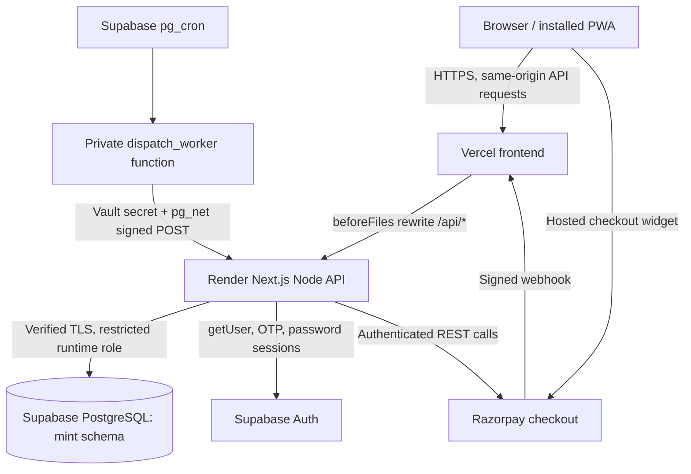
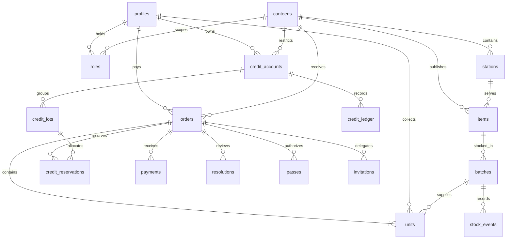
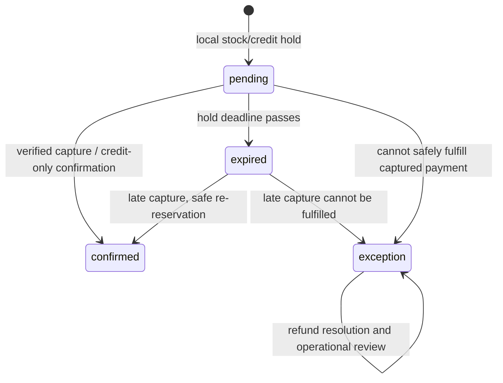

# MINT Technical Documentation

MINT is an installable campus canteen pickup application. This document describes its implemented architecture, technology stack, database schema, API contracts, security boundaries, algorithms, financial rules, deployment, and maintenance procedures.

Use the [documentation map](README.md) to choose a guide by task. Read the [system architecture](architecture/overview.md) for the component map and [core workflows](architecture/workflows.md) for end-to-end behavior. This file is the detailed reference for exact contracts and invariants.

**Documentation baseline:** 11 October 2026. Versions and policy values reflect the repository at this baseline. Source code and migrations define behavior when this reference and a later revision differ.

For deployment procedures, see [Deployment](DEPLOYMENT.md). For campus menu data and import behavior, see [Campus menu](frontend/CAMPUS_MENU.md). Delivery and other proposal documents describe planned scope rather than shipped features.

## Contents

1. [Project overview](#1-project-overview)
2. [Implemented scope and boundaries](#2-implemented-scope-and-boundaries)
3. [Architecture and request flow](#3-architecture-and-request-flow)
4. [Technology choices and alternatives](#4-technology-choices-and-alternatives)
5. [Repository map and function ownership](#5-repository-map-and-function-ownership)
6. [Database schema and relationships](#6-database-schema-and-relationships)
7. [Database invariants and indexes](#7-database-invariants-and-indexes)
8. [Authentication, authorization, and security](#8-authentication-authorization-and-security)
9. [Complete endpoint reference](#9-complete-endpoint-reference)
10. [Checkout and inventory algorithm](#10-checkout-and-inventory-algorithm)
11. [Payment verification and failure recovery](#11-payment-verification-and-failure-recovery)
12. [Wallet expiry and fine accounting](#12-wallet-expiry-and-fine-accounting)
13. [Pickup, geofencing, QR, and delegation](#13-pickup-geofencing-qr-and-delegation)
14. [Order limits and reliability algorithm](#14-order-limits-and-reliability-algorithm)
15. [Concurrency, transactions, and idempotency](#15-concurrency-transactions-and-idempotency)
16. [Worker and durable scheduling](#16-worker-and-durable-scheduling)
17. [Frontend, PWA, and user experience](#17-frontend-pwa-and-user-experience)
18. [Reporting, deployment, and operations](#18-reporting-deployment-and-operations)
19. [Policy constants and configuration](#19-policy-constants-and-configuration)
20. [Algorithms and complexity](#20-algorithms-and-complexity)
21. [Testing and evidence](#21-testing-and-evidence)
22. [Known limitations and production requirements](#22-known-limitations-and-production-requirements)
23. [Failure behavior reference](#23-failure-behavior-reference)
24. [Development and maintenance](#24-development-and-maintenance)
25. [Glossary](#25-glossary)

## 1. Project overview

MINT is an installable campus canteen pickup application. Students use verified university accounts to order from Main, IT, or MBA canteens. They pay through Razorpay or same-canteen wallet credit. The backend reserves actual inventory before payment and records each portion independently. Students can collect their portions or assign selected portions to a verified friend. Staff confirm arrival through a pickup-pass scan or the student checks in through a geofence. Preparation and handover are separate actions. PostgreSQL transactions, locks, constraints, and idempotent event keys protect stock and money. A background worker releases expired checkout holds, processes missed pickups, reconciles payments, and retries financial exceptions. New cancellation credits expire after 30 days. A missed paid pickup without arrival returns 90% credit and retains a 10% fine.

The system coordinates **inventory, payment, pickup rights, and expiring credit** through shared transactional workflows.

Core domain concepts:

| Concept | Meaning |
| --- | --- |
| Order | Payment and checkout container |
| Unit / portion | One food portion with its own collector and fulfillment state |
| Batch | Physical inventory bucket with held, committed, and waste counts |
| Credit account | One student's balance at one canteen |
| Credit lot | One credit grant with its own expiry |
| Pass | Random bearer token restricted to a collector, order, and station |
| Resolution | Durable provider-refund job for a financial exception |

## 2. Implemented scope and boundaries

### Who uses the system?

- **Student:** university email OTP, menu, cart, payment, orders, pickup, sharing, wallet, private profile.
- **Serving staff:** assigned counter, QR resolution, arrived preparation jobs, selected handover.
- **Cashier:** canteen-scoped walk-in stock sale API. This is a stock/value record, not a second Razorpay checkout.
- **Manager:** assigned canteen dashboard, menu and stock controls, exceptions, staff scopes, and audited reviews.
- **Administrator tooling:** provisions identities, migrations, restricted runtime credentials, menus, and scheduler configuration.

Identity kind and operational role are different. A staff identity does not automatically become a manager. A manager role in Main does not authorize actions in IT.

### What is deliberately outside the current implementation?

There is no campus delivery service, rider matching, route optimizer, food recommendation model, demand forecasting model, chatbot, or native Android/iOS application. Delivery proposals are not implemented features. This is a pickup PWA.

The runtime uses no AI model, model API, trained weights, embedding store, inference service, or ML dependency. Reliability tiers, quotas, geofencing, and financial rules are explicit code and SQL.

Development tools are separate from product inference. The runtime does not call an AI model or require model credentials.

## 3. Architecture and request flow

### Deployment diagram



Both hosts build the same Next.js repository. They have different operational roles. Vercel serves the app and assets. Its API rewrite forwards requests before bundled API route handlers execute. Render performs normal application database and provider work.

The browser uses relative `/api/...` URLs. This keeps the browser's session cookie and request origin associated with the frontend domain. The database never receives browser-supplied SQL or a student database connection.

Deployment origins are configured through `APP_URL` and `BACKEND_URL`. The current hosting configuration redirects the secondary frontend alias to the canonical frontend so origin checks remain consistent.

### One checkout request, end to end

1. React sends `POST /api/checkouts` with item IDs, quantities, displayed prices, requested credit, policy version, and retry key.
2. `handle()` checks the origin and supplies stable error handling.
3. `actor()` verifies the Supabase user and approved identity.
4. Zod validates the request shape; `student()` restricts checkout to students.
5. `hold()` opens a database transaction and acquires student and canteen advisory locks.
6. The transaction expires due state, checks a previous retry, verifies policy and quotas, and reserves inventory and credit.
7. The database commits the local hold. A credit-only order confirms locally. Otherwise the backend creates a Razorpay order outside the business transaction.
8. The browser opens Razorpay's widget. Callback, webhook, or reconciliation obtains a captured provider payment.
9. `applyCaptured()` and `confirmTx()` move held inventory and credit into committed fulfillment.

The external payment cannot participate in a PostgreSQL transaction. Durable intermediate states and reconciliation bridge that boundary.

### Architecture classification

The application is a **modular monolith with a split frontend/backend deployment**. Business modules share one codebase and database. TypeScript modules are not independent microservices. The database does not enforce every business rule: SQL constraints enforce selected invariants, while TypeScript and transactional SQL enforce workflows.

## 4. Technology choices and alternatives

Versions below are declared in `package.json`. A caret range is a declared dependency range, not proof of the exact package version installed on every host.

| Technology | Declared version | Actual responsibility | Why this choice fits |
| --- | --- | --- | --- |
| Next.js | 16.4.0 | App Router, route handlers, build and hosting | One TypeScript project for UI and API |
| React / React DOM | 19.3.0 | Stateful browser UI | Reusable views and component state |
| TypeScript | 6.0.3 | Static checking in strict mode | Detects many development mistakes; does not validate network input |
| Tailwind CSS | 4.3.3 | Styling support with custom CSS | Consistent visual primitives |
| Radix / Slot / CVA | See package manifest | UI composition and variants | Reuse installed primitives |
| Lucide React | 1.55.0 | Icons | One consistent icon set |
| Drizzle ORM | ^0.45.4 | Schema, migrations, parameterized SQL | Relational model with direct control over locking SQL |
| Drizzle Kit | ^0.31.11 | Generates migration artifacts | Tracks schema changes |
| Postgres.js | 3.4.9 | Database wire driver and connection pool | Supports transactions and parameterized queries |
| Supabase SSR | ^0.12.7 | Server session-cookie integration | Integrates hosted Auth with Next.js |
| Supabase JS | ^2.117.3 | Auth/admin tooling integration | Managed identity rather than custom password storage |
| Zod | 4.6.5 | HTTP, profile, configuration, import validation | Runtime trust-boundary checks |
| Razorpay REST | No server SDK required | Orders, payment inspection, exception refunds | Small `fetch` adapter with explicit signatures and timeouts |
| qrcode | 1.5.4 | Encodes pickup token as a QR image | QR generation, not identity verification |
| ZXing Browser | 0.2.1 | Camera QR decoding | Reads camera frames in the browser |
| Node crypto | Standard library | Random tokens, SHA-256, HMAC, timing-safe comparison | No new cryptography dependency |
| Playwright | 1.64.0 | Browser tests | Layout, navigation, API contracts, camera simulation |
| node:test + tsx | Built-in test runner / ^4.23.15 | Pure policy and database workflow tests | Executes TypeScript tests without another test framework |
| Python 3 standard library | Host-dependent | Optional laptop backend-health monitor | No additional backend endpoint or service |
| Supabase Cron / pg_net / Vault | Hosted database facilities | Durable scheduler and private dispatch secrets | Worker does not depend on an open browser or laptop |

**Why PostgreSQL instead of a document database?** Orders, portions, batches, accounts, and roles have real relations. Foreign keys, transactions, row locks, and check constraints directly support the correctness requirements.

**Why Supabase?** It supplies PostgreSQL, Auth, and operational extensions. This app uses its database through the backend driver. It does not rely on the browser querying business tables through Supabase REST.

**Why a PWA?** One web implementation can be installed and used on phones. Tradeoffs include browser-dependent installation, camera/location permissions, and a much smaller offline capability than a native application.

**Why not Redux, Redis, Kafka, or an AI model?** Current needs use React state and PostgreSQL durable state. Those tools add complexity without solving a demonstrated requirement. This is a design tradeoff, not a claim that they could never help at larger scale.

## 5. Repository map and function ownership

| File | What to explain in a source walkthrough |
| --- | --- |
| [src/app/layout.tsx](../src/app/layout.tsx) | Persistent `MintApp` shell, manifest metadata, viewport |
| [src/app/[...screen]/page.tsx](../src/app/[...screen]/page.tsx) | Allowed screen paths; asynchronous route params; invalid paths use `notFound()` |
| [src/components/mint-app.tsx](../src/components/mint-app.tsx) | Student/staff screens, API helper, polling, cart, checkout, QR, navigation |
| [src/components/manager-dashboard.tsx](../src/components/manager-dashboard.tsx) | Manager summary presentation and separated financial figures |
| [src/components/profile-form.tsx](../src/components/profile-form.tsx) | Private profile interaction |
| [src/components/install-prompt.tsx](../src/components/install-prompt.tsx) | Native install event and manual install guidance |
| [src/app/globals.css](../src/app/globals.css) | Fixed app frame, inner scrolling, responsive layouts, floating notices |
| [src/app/api/[...path]/route.ts](../src/app/api/[...path]/route.ts) | API dispatcher and request schemas |
| [src/lib/http.ts](../src/lib/http.ts) | Origin check, JSON size validation, error envelope |
| [src/lib/auth.ts](../src/lib/auth.ts) | Server cookie client and verified `actor()` |
| [src/modules/core.ts](../src/modules/core.ts) | SQL helpers, `scope`, `atomic`, `rate`, audit, tokens, order ownership |
| [src/modules/orders.ts](../src/modules/orders.ts) | Hold, confirm, expire, cancel, per-portion stock/credit changes |
| [src/modules/payments.ts](../src/modules/payments.ts) | Provider setup, captured payment application, reconciliation and refunds |
| [src/lib/razorpay.ts](../src/lib/razorpay.ts) | Provider adapter and signature verification |
| [src/modules/credits.ts](../src/modules/credits.ts) | Account locks, credit lots, reservation allocations, expiry, rolling-release replay |
| [src/lib/credit-policy.ts](../src/lib/credit-policy.ts) | Policy identifier and rounded missed-pickup calculation |
| [src/modules/pickup.ts](../src/modules/pickup.ts) | Haversine check-in, arrival, passes, invitations, returned rights |
| [src/modules/operations.ts](../src/modules/operations.ts) | Resolve, handover, preparation, cashier sale, manager actions |
| [src/modules/order-limits.ts](../src/modules/order-limits.ts) | SQL history and usage computation |
| [src/lib/order-limits.ts](../src/lib/order-limits.ts) | Tier thresholds and item-allowance rules |
| [src/modules/catalogue.ts](../src/modules/catalogue.ts) | Public catalogue and private account/order/manager views |
| [src/modules/manager-summary.ts](../src/modules/manager-summary.ts) | Campus-time report aggregation |
| [src/modules/profiles.ts](../src/modules/profiles.ts) | Name/phone validation and identity-safe updates |
| [src/jobs/auth.ts](../src/jobs/auth.ts), `tick.ts`, `worker.ts` | Signed worker authorization, one tick, local loop |
| [src/db/schema.ts](../src/db/schema.ts), [src/db/index.ts](../src/db/index.ts) | Tables/constraints and verified-TLS connection |
| [drizzle/](../drizzle/) | Applied schema/security/scheduler changes and snapshots |
| [data/campus-menu.json](../data/campus-menu.json), [scripts/replace-menu.ts](../scripts/replace-menu.ts) | Menu source and stable-ID importer |
| [next.config.ts](../next.config.ts), [render.yaml](../render.yaml), [vercel.json](../vercel.json) | API routing, canonical alias, hosting settings |
| [scripts/configure-hosted-worker.ts](../scripts/configure-hosted-worker.ts) | Vault configuration and 30-second cron job |
| [tests/workflows.test.ts](../tests/workflows.test.ts), [tests/browser/](../tests/browser/) | Financial/concurrency evidence and UI contract checks |

`Row = Record<string, unknown>` is used around raw SQL results. It is flexible, but less type-safe than fully typed query projections. TypeScript assertions do not prove a provider's JSON shape.

## 6. Database schema and relationships

All application tables use the private PostgreSQL schema `mint`. Most IDs are random UUIDs. Provider payment and event IDs remain text. Timestamps use `timestamptz`; the application treats them as strings and formats campus displays in IST.

### Relationship diagram



The diagram is conceptual. For example, a pass also references collector and station. It does not assert every conceptual relationship is a database foreign key.

### All 22 application tables

| Table | Important columns | Keys / links / meaning |
| --- | --- | --- |
| `profiles` | `id`, `email`, `name`, `kind`, `phone`, `completed_at`, `created_at` | UUID PK comes from Auth identity; unique email. No declared FK to `auth.users` in the Drizzle schema |
| `allowed_identities` | `email`, `kind` | Email PK; administrator-controlled exceptions/staff eligibility |
| `canteens` | `id`, `name`, `lat`, `lng`, `radius`, `max_accuracy`, `paused`, `demo`, `collection_minutes` | Unique name; coordinates stored as text and converted for distance calculation |
| `stations` | `id`, `canteen_id`, `name`, `paused` | FK canteen; unique `(canteen_id,name)` |
| `roles` | `id`, `user_id`, `canteen_id`, `station_id`, `role` | FKs to identity, canteen, optional station; operational authorization |
| `items` | `id`, `canteen_id`, `station_id`, `name`, `price`, `mode`, `note`, `category`, `order_group`, `order_cap`, `archived`, `default_quantity`, `paused` | Price in paise; ready/made mode; group quota classification; archive preserves history |
| `batches` | `id`, `item_id`, `total`, `held`, `committed`, `waste`, `reusable`, `created_at` | FK item; actual inventory bucket |
| `credit_accounts` | `id`, `user_id`, `canteen_id`, `available`, `reserved` | Unique student/canteen pair; aggregate balance |
| `orders` | `id`, `reference`, `payer_id`, `canteen_id`, `state`, `total`, `credit`, `external`, `request_key`, `request_hash`, `provider_order`, `payment_id`, `hold_until`, `confirmed_at`, `target_at`, `deadline`, `policy`, `created_at`, `reconcile_at`, `next_payment_check_at` | Unique reference, retry key, provider order, payment ID; local financial container |
| `units` | `id`, `order_id`, `item_id`, `batch_id`, `station_id`, `name`, `order_group`, `price`, `credit`, `external`, `mode`, `collector_id`, `version`, `state`, `arrived_at`, `ready_at`, `collection_deadline`, `collected_at`, `resolved`, `credit_returned`, `missed_pickup_fine`, `token` | One portion; name/price/group snapshots; unique display/preparation token |
| `credit_ledger` | `id`, `account_id`, `amount`, `reserved_delta`, `source`, `reason`, `order_id`, `actor_id`, `created_at`, `lots_processed` | Unique source; available and reserved deltas; replay marker |
| `credit_lots` | `id`, `account_id`, `source`, `order_id`, `available`, `reserved`, `expired`, `expires_at` | Unique source; each grant retains its own deadline |
| `credit_reservations` | `order_id`, `lot_id`, `amount` | Composite PK `(order_id,lot_id)`; links held checkout money to original lots |
| `stock_events` | `id`, `batch_id`, `quantity`, `kind`, `source`, `actor_id`, `created_at` | Unique source; inventory event history |
| `passes` | `id`, `hash`, `order_id`, `collector_id`, `station_id`, `versions`, `expires_at`, `created_at` | Unique SHA-256 token hash; JSONB map of portion versions |
| `invitations` | `id`, `order_id`, `sender_id`, `recipient_id`, `versions`, `state`, `created_at` | Transfer proposal and version snapshot |
| `audit_events` | `id`, `actor_id`, `action`, `entity`, `source`, `data`, `created_at` | Unique source; text entity and JSONB details; actor ID has no declared FK |
| `provider_events` | `id`, `kind`, `state`, `payment_id`, `created_at` | Provider event ID PK; durable pending/processed marker |
| `payments` | `id`, `order_id`, `amount`, `status`, `created_at` | Provider payment ID PK; FK local order |
| `resolutions` | `id`, `order_id`, `payment_id`, `amount`, `reason`, `state`, `provider_refund`, `attempts`, `retry_at`, `claimed_until`, `last_error`, `created_at` | Unique payment ID; durable refund work; payment ID is not declared FK to `payments` |
| `rate_limits` | `key`, `count`, `reset_at` | Key PK; shared database fixed-window rate limiter |
| `worker_health` | `name`, `last_at`, `error` | Named heartbeat PK; managers inspect freshness |

### Why separate order and portion?

An order can contain two ready snacks and one made-to-order drink. One snack may go to a friend. A different station prepares the drink. One portion can be collected while another expires. One order state cannot represent all those independent outcomes.

`orders.state='confirmed'` means payment/commitment succeeded. It does not necessarily mean the food remains outstanding. UI completion is derived from the portions. All portions can be collected while the order row remains confirmed.

### Why snapshots and JSONB?

Portion name, price, mode, and order group capture what was bought. Changing a menu price must not rewrite receipts or quota classification for paid history.

Passes and invitations use JSONB version maps because they capture a varying set of portion IDs. Audit JSONB holds action-specific detail. Core money and stock remain relational columns with constraints.

This is not full event sourcing. Current counters and states are stored alongside histories. Nor is the schema perfectly normalized: snapshots deliberately duplicate purchased attributes.

## 7. Database invariants and indexes

### Inventory invariant

```text
available = total - held - committed - waste
total, held, committed, waste >= 0
held + committed + waste <= total
```

The `batch_capacity` constraint protects this even if an application statement is wrong. A positive quantity displayed in the UI is still only a recent observation; checkout rechecks and locks stock.

### Money invariants

```text
order.credit + order.external = order.total
order.total > 0
unit.credit + unit.external = unit.price
credit_account.available >= 0
credit_account.reserved >= 0
unit.credit_returned + unit.missed_pickup_fine <= unit.price
```

Amounts are integer paise. ₹123.45 is `12345`, not a floating rupee value. JavaScript safe-integer checks protect ledger deltas. PostgreSQL `integer` remains a 32-bit storage bound; aggregate reports use `bigint`. Unlimited long-term growth is not guaranteed by JavaScript number safety alone.

Lot/account equality is an application accounting invariant; it is not a cross-table SQL CHECK. Tests compare account balances with lot allocations. Nonnegative constraints alone would not detect every bookkeeping mismatch.

### Principal indexes and why they exist

| Index / unique key | Why it matters |
| --- | --- |
| `credit_owner(user_id,canteen_id)` | One wallet account per canteen; account lookup/upsert |
| `orders.request_key` unique | One local checkout per payer retry key |
| `orders.provider_order`, `orders.payment_id` unique | Prevent conflicting main provider linkage |
| `credit_ledger.source`, `stock_events.source`, `audit_events.source` unique | Duplicate financial/stock/audit effect detection |
| `payments.id`, `provider_events.id`, `resolutions.payment_id` unique | Captured payment, webhook and refund-job deduplication |
| `orders_payer` | Account order/history lookup |
| `orders_expiry(state,hold_until)` | Pending checkout expiry search |
| `units_order`, `collector_units(collector_id,order_id)` | Order details and delegated pickup ownership |
| `station_worklist(station_id,state)` | Staff outstanding work |
| `menu_canteen`, `batch_item` | Catalogue and stock allocation |
| `roles_user` | User role lookup |
| `audit_entity_action_time` | History-based reliability and action queries |
| `credit_lots_account_expiry(account_id,expires_at)` | Earliest-expiry spending and account lot reads |
| Partial `credit_lots_due(expires_at) WHERE available>0` | Expire only lots that still have spendable balance |
| Partial `credit_ledger_unprocessed` | Rolling-release replay of only pending entries |

Indexes trade read speed for write/storage cost. No blanket claim is made that every foreign key or every predicate has an optimal index. Index changes should follow query-plan and workload measurements.

UUIDs reduce predictable sequential identifiers. They do not replace ownership checks. A guessed valid order UUID must still fail authorization.

## 8. Authentication, authorization, and security

### Student and staff authentication

Student OTP requests allow `@cb.students.amrita.edu`. Supabase creates/verifies the identity and email session. The app does not implement password hashing or store OTPs in its own tables.

Staff password login requires an email present in `allowed_identities`. Administrator tooling provisions these identities. The backend then uses Supabase's password sign-in service.

For protected calls, `actor()` calls `auth.getUser()`, requires a confirmed email, classifies the identity, and upserts the application's profile. It does not trust a posted `userId`, client role, or an unchecked decoded JWT.

`allowed_identities` overrides the general university-domain classification. Other verified university addresses become students. Other addresses are rejected. A before-user-created **Auth hook function** also restricts direct signup. Setup configures this function as a Supabase Auth hook rather than an ordinary table trigger.

### Cookie sessions

Supabase SSR manages session cookies through Next.js `cookies()`. The wrapper makes cookies HttpOnly, SameSite=Lax, and Secure when `APP_URL` uses HTTPS.

HttpOnly reduces direct token theft through JavaScript. It does not make XSS harmless: injected code can still make actions as the user. SameSite and exact origin checks reduce cross-site request abuse. HTTPS protects transport, not an infected device.

### Authorization rules

- `student()` checks identity kind for student workflows.
- `scope()` checks a role in the requested canteen and, when supplied, the requested station.
- Managers with a canteen-level role can act across that canteen's stations.
- An unrelated existing order returns 403; an absent order returns 404. This response distinction can expose whether an order exists.
- Only the payer can verify payment or cancel portions.
- Delegates can collect assigned portions; they cannot retrieve payer money or delegate further.
- The profile endpoint updates only the authenticated identity's name and phone.

Sensitive staff mutations recheck scope inside their transaction. That reduces stale authorization reliance. The role query itself is not a fully locked revocation protocol, so instantaneous revocation is not guaranteed for every race.

### Private database boundary

Migrations revoke business-schema privileges from `public`, `anon`, and `authenticated`, and enable RLS on application tables. The backend uses `mint_backend`. Its RLS policy allows server access to business rows. Therefore **student isolation is enforced by backend authorization and response projection**, not by a per-student RLS policy.

`0002_runtime_role.sql` initially creates a NOLOGIN role. `scripts/runtime-role.ts` changes it to LOGIN with a generated password for the runtime connection. The deployed runtime connection therefore uses a login-enabled restricted role.

The runtime role lacks migration/create privileges and has SELECT-only access to `allowed_identities`. Migration credentials are separate. A compromised backend still has substantial business-data access; private schema and RLS do not eliminate that risk.

### CSRF, input validation, and errors

Every non-GET ordinary API request must have an `Origin` equal to the configured `APP_URL` origin. Missing and foreign origins are rejected with `BAD_ORIGIN`. The payment webhook uses its HMAC signature instead. The internal worker uses separate signed authentication.

Zod validates IDs, enumerations, ranges, quantities, strings, and uniqueness for relevant arrays. `body()` checks advertised body size and actual raw string length against 32,768; the latter counts JavaScript string units, not exact UTF-8 bytes. Webhooks cap raw text length at 262,144. The regular parser buffers text before checking its actual length; this is not a streaming ingress limit.

Drizzle SQL interpolation parameterizes values. `sql.join` constructs lists from parameter fragments. Administrator role tooling uses an explicitly formatted statement for role configuration; it is not an HTTP endpoint accepting arbitrary SQL.

Errors return:

```json
{"code":"PRICE_CHANGED","message":"The menu price changed. Review the refreshed cart before checkout.","retryable":false}
```

Zod errors return 400, authorization errors commonly 401/403, conflicts commonly 409, rate limits 429, unexpected failures 500. `AppError` defaults to 409. Retryable flags are currently set for rate limits, payment pending, and provider unavailable; they are not a universal automatic-retry policy.

### Rate limits

The limiter atomically upserts a shared PostgreSQL counter. A key receives a reset timestamp on the first request. The window resets when that timestamp passes. This is a **fixed window anchored to the first request**, not a sliding log or token bucket.

| Operation | Requests | Window | Key |
| --- | --- | --- | --- |
| OTP request | 1 | 60 seconds | Hashed email |
| OTP requests | 5 | 1 hour | Hashed email |
| OTP verification | 5 | 5 minutes | Hashed email |
| Password login | 5 | 5 minutes | Hashed email |
| Checkout | 30 | 60 seconds | Actor ID |
| Payment verification | 20 | 60 seconds | Actor ID |
| Location check-in | 20 | 60 seconds | Actor ID |
| Pass generation | 30 | 60 seconds | Actor ID |
| Pickup invitation | 10 | 60 seconds | Actor ID |
| Staff resolve | 30 | 60 seconds | Actor ID |

This limiter shares state across processes. It does not provide comprehensive IP-based DDoS protection, and an attacker can target a known email's quota. Hosting/provider protections are separate.

### Cryptography

- SHA-256 hashes random pickup-pass tokens and request fingerprints. Hashing is not reversible encryption.
- `randomBytes(32)` supplies pass-token randomness. It is not `Math.random()`.
- HMAC-SHA256 verifies payment callbacks, webhooks, and scheduler signatures using different configured secrets.
- `timingSafeEqual` compares equal-length validated signatures.
- Database TLS validates the committed Supabase CA and rejects unauthorized certificates.

Frontend headers set `X-Content-Type-Options: nosniff`, `Referrer-Policy: same-origin`, and camera/geolocation Permissions-Policy. There is no explicit application CSP or frame-ancestors policy in `next.config.ts` at this revision. These headers are not currently configured by the application.

## 9. Complete endpoint reference

API success responses are operation-specific JSON. Some successful functions return no value; the wrapper emits `{ok:true}`. IDs are UUIDs unless they are provider references. All money fields use paise.

### Public and authentication

| Method and path | Input | Result / condition |
| --- | --- | --- |
| `GET /api/health` | None | Database `select 1`; status/service/backend commit |
| `GET /api/catalogue` | None | Main/IT/MBA canteens, stations, current unarchived items, stock and server time |
| `POST /api/auth/request` | `{email}` | University OTP request; origin and email limits |
| `POST /api/auth/verify` | `{email,token}` | Six-digit OTP verification; session cookies |
| `POST /api/auth/password` | `{email,password}` | Approved identity; password 8–100 characters |
| `POST /api/auth/logout` | `{}` | Supabase sign-out; clear session cookies |
| `POST /api/payments/webhook` | Raw provider JSON plus `x-razorpay-signature`; optional event ID header | HMAC-authenticated provider processing; no user cookie needed |

### Authenticated student and account routes

| Method and path | Input | Authorization / effect |
| --- | --- | --- |
| `GET /api/me` | None | Own actor, profile, roles; student orders, limits, credits, ledger, invitations |
| `POST /api/profile` | `{name,phone}` | Own profile only; name 2–80; normalized Indian mobile number |
| `GET /api/orders/:id` | Order UUID | Payer or assigned collector; payer financial projection only |
| `POST /api/checkouts` | `{canteenId,policy,lines:[{itemId,quantity,price}],credit,key}` | Student; creates/retries hold; credit-only confirm or payment setup |
| `POST /api/orders/:id/payment` | `{paymentId,providerOrder,signature}` | Payer; validates callback and fetches actual provider payment |
| `POST /api/orders/:id/payment-setup` | `{}` | Payer; resumes existing provider setup path |
| `POST /api/orders/:id/check-in` | `{latitude,longitude,accuracy,timestamp}` | Student related to order; records only own assigned arrival |
| `POST /api/orders/:id/passes` | `{}` | Student; station passes for own outstanding confirmed portions |
| `POST /api/orders/:id/invite` | `{ids:[portionUUID],email}` | Payer; exact known student recipient; no further delegation |
| `POST /api/orders/:id/cancel` | `{ids:[portionUUID]}` | Payer; eligible pending portions only |
| `POST /api/orders/:id/return` | `{ids:[portionUUID]}` | Delegate; returns assigned outstanding rights to payer |
| `POST /api/invitations/:id` | `{action:"accept"|"decline"|"withdraw"}` | Recipient accepts/declines; sender withdraws |

Checkout's API permits 1–20 distinct lines, integer line quantity 1–20, positive price, nonnegative credit, retry key 8–100 characters, and optional policy string up to 100. Business caps are stricter than parser bounds. Missing/wrong current policy blocks **new** checkout with `POLICY_CHANGED`. An exact existing legacy retry is checked before that guard.

Shared `ids` arrays permit 1–100 unique UUIDs. Latitude is −90 to 90; longitude −180 to 180; accuracy is positive and at most 100,000; timestamp is a positive integer. Actual acceptable accuracy is much tighter in canteen configuration.

### Staff routes

| Method and path | Input | Effect |
| --- | --- | --- |
| `GET /api/staff/worklist?station=:uuid` | Station query parameter | Serving/manager station scope; arrived active portions and recent collections |
| `POST /api/staff/resolve` | `{stationId,token}` or `{stationId,reference,collector}` | Resolve QR, or manual lookup; QR can establish arrival, reference cannot |
| `POST /api/staff/handover` | `{stationId,portions:[{id,version}],key}` | Confirm exact ready, arrived, current-version portions once |
| `POST /api/staff/preparation` | `{id,action:"start"|"ready"}` | Made-to-order state transition after arrival |
| `POST /api/cashier/sales` | `{canteenId,lines:[{itemId,quantity}],key}` | Cashier/manager stock commitment and audited sale total |

Handover permits 1–100 unique portions and positive versions. Cashier lines permit 1–20 unique items and quantity 1–100. The cashier endpoint records `paymentMethod:"cashier-recorded"`; it does not verify collection of cash or produce a Razorpay payment record.

### Manager and internal routes

| Method and path | Input / output |
| --- | --- |
| `GET /api/manager/:canteenId` | Full scoped operations view: exceptions, resolutions, payment reviews, batches, worker, aggregate report, recent audit |
| `GET /api/manager/:canteenId/summary?period=today|week` | Scoped overview; default today; week means current campus day plus preceding six days |
| `POST /api/manager/:canteenId` | One discriminated action below, with retry `key` |
| `POST /api/internal/worker` | Signed timestamp headers; invokes tick; 401 unauthenticated or 503 retry on failure |

### Every manager action

| `action` | Additional fields | Important rule |
| --- | --- | --- |
| `limits-review` | `email,reason` | Student history must exist in assigned canteen; writes review audit marker |
| `item-settings` | `itemId,name,price,note,paused,defaultQuantity,expectedSettings,reason`; optional `orderCap,expectedOrderCap` | Rejects stale fields/cap; preserves paid snapshots |
| `stock` | `itemId,quantity,expectedAvailable,reason` | Sets sellable availability 0–10,000; rejects stale quantity; protects holds/commitments |
| `prepared-resolution` | `unitId,reason` | Preparing/ready portion; manager-approved full credit and food withdrawn as waste |
| `item` | `itemId,stationId,name,price,mode,note,reason` | Create/update scoped item; readiness mode cannot change for existing item |
| `pause` | `paused,reason`; optional `itemId` or `stationId` | Pauses item, station, or whole canteen for new orders |
| `batch` | `itemId,quantity,reusable,reason` | Adds new inventory batch; quantity 1–10,000 |
| `waste` | `batchId,quantity,reason` | Withdraws only uncommitted stock |
| `price` | `itemId,price,reason` | Changes future price only |
| `geofence` | `latitude,longitude,radius,maxAccuracy,demo,reason` | Radius 10–500 m; max accuracy 1–100 m |
| `extend` | `minutes,reason` | Extends target/final arrival for outstanding confirmed orders; 1–120 minutes |
| `collection-review` | `unitId,minutes,reason` | Arrived outstanding portion; collection deadline becomes now plus extension |
| `unavailable` | `unitId,reason` | Pending portion; full cancellation credit and forced stock withdrawal |
| `scope` | `email,role,reason`; optional `stationId` | Provisioned staff only; serving needs station; `none` removes canteen scope |

Most reasons require 3–300 characters; prepared-resolution requires at least 10. Manager price inputs permit up to 1,000,000 paise. Role values are serving/cashier/manager/none.

The API is RPC-like JSON over HTTP, not a strict textbook REST resource design. It has no checked-in OpenAPI contract or separately versioned `/v1` namespace. The business policy is versioned independently.

## 10. Checkout and inventory algorithm

### `hold()` in exact conceptual order

1. Require student identity and hash the request excluding the retry key.
2. Begin transaction; lock student first, canteen second.
3. Expire due credit, pending holds, and eligible missed arrivals in the canteen.
4. Find an order by `actorId:key`. Same hash returns the original order; different hash rejects the retry.
5. Require current disclosed credit policy.
6. Compute campus-wide student limits and reject cooldown/cap violations.
7. Check canteen exists and accepts new orders; reject duplicate item lines.
8. Sort item IDs for deterministic allocation order.
9. Fetch each authoritative menu item and reject wrong canteen, archived/paused item, paused station, changed price, or inadequate availability.
10. Apply same-item, meal, drink, and outstanding restrictions.
11. Lock batches ordered by `created_at,id`; allocate oldest batch first and increment `held`.
12. Validate requested credit and lock/refresh its same-canteen account.
13. Insert the order with a three-minute hold and current policy snapshot.
14. Reserve earliest-expiring available credit lots, if credit is requested.
15. Insert one unit per portion, including snapshot data and apportioned credit.
16. Insert stock-hold events and checkout audit; commit.

If any item fails, the transaction rolls back **all** previously allocated items, credit reservations, and new rows. There is no partially reserved cart left behind.

### Inventory state transitions

| Event | Held | Committed | Waste | Available |
| --- | --- | --- | --- | --- |
| Pending checkout for one portion | +1 | 0 | 0 | −1 |
| Payment confirms its valid hold | −1 | +1 | 0 | unchanged |
| Unpaid hold expires | −1 | 0 | 0 | +1 |
| Pending reusable confirmed portion cancels | 0 | −1 | 0 | +1 |
| Nonreusable/prepared portion is withdrawn | 0 | −1 | +1 | unchanged |
| Cashier sells one available portion | 0 | +1 | 0 | −1 |
| Staff hands over committed portion | 0 | 0 | 0 | unchanged |

Handover must not subtract stock again. Commitment already removed it from availability. `committed` therefore includes sold/collected portions, not just food waiting on a shelf.

### Example: last two portions

Batch: total 10, held 1, committed 6, waste 1. Available is 2. Two concurrent students each request 2. The first canteen transaction holds both; the next sees zero and fails. A cashier uses the same canteen lock and cannot sell the same final portions simultaneously.

### Proportional credit allocation

The order's credit is distributed across units by cumulative floor arithmetic:

```text
nextAllocated = floor(cumulativePrice * orderCredit / orderTotal)
unitCredit = nextAllocated - previousAllocated
unitExternal = unitPrice - unitCredit
```

Example: prices 101 and 202 paise, total 303, credit 100. First unit gets 33 credit, second gets 67. Their credit sums to exactly 100. Rounding each portion independently could lose or create a paise. Cancellation later uses the unit price under the applicable rule, not a recomputation from current menu prices.

## 11. Payment verification and failure recovery

### Payment creation

`createPayment()` checks payer ownership, external amount, pending state, and hold deadline. If `provider_order` already exists, it returns it.

Before calling the provider, it atomically claims setup using `reconcile_at` only when no provider order or claim exists. The provider request uses INR, the exact external amount, and local order UUID as receipt and note. It times out after 15 seconds.

If the provider creates an order but the response is lost, MINT does not blindly create another one. The reconciliation worker searches provider orders by receipt and validates receipt, amount, and currency.

This prioritizes avoiding duplicate payment setup. It also has a limit: if a claimed creation definitely never reached the provider and no matching receipt exists, the current code does not automatically clear the claim and retry a new provider order. The pending review may need operational handling/new checkout after expiry. This case does not have a guaranteed automatic repair time.

### Three confirmation channels

| Channel | Why it exists | Authority check |
| --- | --- | --- |
| Browser callback | Fast feedback while checkout remains open | HMAC of provider order/payment IDs, then server fetch |
| Provider webhook | Browser may close or lose connectivity | HMAC of raw payload, then server fetch |
| Worker reconciliation | Callback/webhook may be absent or delayed | Server-to-provider API and captured-state validation |

The callback signature covers `providerOrder + '|' + paymentId` using the Razorpay key secret. The webhook signature covers the raw request body using the webhook secret. Parsing and reserializing JSON before verification would change signed bytes.

The provider payment must be captured, report captured=true, have matching amount, INR currency, and provider-order linkage. Authorized/pending payment is not enough.

### Captured-payment application

`applyCaptured()` finds the local provider-linked order, acquires student/canteen locks, runs expiry, locks the order, and verifies payment values. It uses provider payment ID as the capture deduplication key.

- Same payment ID again: return existing outcome.
- First valid payment and active hold: convert held stock to committed, consume reserved credit, confirm order.
- Late valid payment: attempt safe re-reservation under current stock, credit, pause, and campus quota conditions.
- Late payment that cannot be fulfilled: persist the capture, mark order exception, enqueue one provider refund resolution.
- A different extra captured payment for an already confirmed order: preserve fulfillment once and enqueue a resolution for the extra capture.
- Amount/currency/linkage mismatch: record payment-mismatch audit, reject application, and expose manager review. This branch does not automatically create a refund resolution.

Late recovery uses the original batches. It does not freely substitute newly added inventory of the same item or override quota rules. Expired credit cannot be reused for late confirmation.

### Refund exception workflow

`claimResolutions()` selects at most five eligible jobs with `FOR UPDATE SKIP LOCKED`, sets processing state, increments attempts, and gives a one-minute claim lease. Different claimers receive disjoint jobs. Expired leases can be reclaimed.

For each job, the worker queries existing provider refunds and matches its resolution UUID receipt before creating one. It also sends `X-Refund-Idempotency`. Processed refunds become completed. Other statuses retry after 30 seconds; request failure retries after one minute.

The retry delays are fixed, not exponential. A one-minute lease cannot exclude every possible long-running overlap. Provider lookup and idempotency protect the external boundary, and operational monitoring remains necessary.

### Payment state diagram



Collected/cancelled/expired food outcomes belong to unit states. A completed provider refund does not necessarily change the order out of exception.

## 12. Wallet expiry and fine accounting

### The wallet is a canteen-specific liability

A student can have Main, IT, and MBA accounts. Main credit cannot pay IT. This credit is not a bank wallet, transferable stored-value product, or a withdrawable cash balance. It is separate from a bank refund.

`credit_accounts` stores fast aggregate available/reserved totals. `credit_lots` preserves the expiry of each grant. `credit_reservations` links an order's held credit to those original grants. `credit_ledger` records changes with unique sources.

### Ledger movement examples

| Movement | Available delta | Reserved delta |
| --- | --- | --- |
| Grant ₹90 cancellation credit | +9000 | 0 |
| Reserve ₹40 for checkout | −4000 | +4000 |
| Confirm reserved ₹40 spend | 0 | −4000 |
| Release unused ₹40 hold | +4000 | −4000 |
| Spend ₹40 directly for safe late capture | −4000 | 0 |
| Expire ₹50 unspent credit | −5000 | 0 |

These are internal balance deltas. There is no paired general-ledger account for every event. The system is not a complete double-entry accounting ledger.

### Expiry semantics

- Each new grant expires exactly 30 days after issue, not at month-end or the end of the displayed date.
- Spending selects `expires_at,id` order: earliest expiry first.
- A single wallet can contain several grants with different deadlines.
- Old balances received one migration-time 30-day grace period; historical refunds were not reduced.
- Account reads, checkout, and scheduled worker operations enforce expiry.
- The UI displays remaining available lot amounts and exact expiry times in IST.
- Expiry writes a negative ledger entry and sets the lot's available balance to zero.

The stored counter may not change at the exact millisecond without an executing request/tick. The transaction enforces eligibility before spend, so scheduler latency does not make expired available credit spendable.

### Reserved credit crossing expiry

Suppose ₹50 expires at 12:00. A student reserves it at 11:59 for a valid three-minute checkout.

- Confirmation at 12:01 can consume that existing reservation.
- If the checkout expires instead, release restores the original lot, whose deadline remains 12:00.
- The restored past-due balance expires immediately in the same workflow.
- Opening and abandoning checkouts cannot continually renew the grant.
- A later captured payment must obtain currently valid available credit; it cannot use an expired released grant.

### Fine calculation and exact eligibility

Current new-order policy: `credit-30d-missed-10-v3-25+5`.

```text
fine = round(unitPrice / 10)       // integer paise, per portion
creditReturned = unitPrice - fine
```

₹100 missed portion returns ₹90 credit and records ₹10 fine. A 999-paise portion records a 100-paise fine and returns 899. At very small prices, rounding can produce a zero-paise fine. This is nearest-paise rounding, not always an exact mathematical 90.000%.

The automatic fine applies to a portion of a confirmed order when **final arrival deadline has passed, `arrived_at` is null, state is pending, and policy equals the current policy**. The database does not infer human intent or negligence.

Collected portions are untouched. Arrived portions waiting for preparation or collection are not automatically fined; overdue collection requires manager review. Ordinary eligible student cancellation and manager-approved canteen failure return full credit. Only the payer receives money, even if a delegate was responsible for pickup.

### Mixed order example

Three portions at ₹100 each. One collected, one voluntarily cancelled before preparation, one misses arrival under the new policy:

```text
Original paid order value: ₹300
Collected food:            ₹100
Cancellation credit:       ₹100
Missed-pickup credit:       ₹90
Missed-pickup fine:         ₹10
Total returned credit:     ₹190
```

The ₹10 fine is included in the ₹300 paid value; adding it again would incorrectly report ₹310. The fine is part of retained original paid value. Credit issued creates a liability; credit spent settles that liability. Provider refund exceptions are separate.

### Policy migration and rolling deploy safety

Orders snapshot their policy. Earlier orders keep full-credit missed-pickup treatment. The old database default remains `demo-credit-v1-25+5` for compatibility; new code explicitly writes the current policy.

The client sends the disclosed policy version. New checkout requires the exact current identifier. An old open tab gets `POLICY_CHANGED` and must reload. An exact existing retry returns the existing order before that check. This guard reduces undisclosed policy changes; it is not proof of legally recorded consent.

Migration `0008` adds lots/allocations and credit/fine fields, locks relevant tables during backfill, and creates private grants and RLS. Migration `0009` adds `lots_processed`, marks represented historical entries processed, and backfills historical unit-return amounts.

During a rolling release, an old writer can produce ledger entries without lot updates. `account()` replays those entries in timestamp/ID order into lots/reservations, then marks them processed. It does not repeat the old writer's account-balance changes.

## 13. Pickup, geofencing, QR, and delegation

### Three different deadlines

| Deadline | Starts from | Meaning |
| --- | --- | --- |
| Checkout hold: 3 minutes | Local checkout creation | Temporary stock/credit reservation |
| Arrival target: 25 minutes; final: 30 minutes | Payment confirmation | Reach pickup area or present pass before final cutoff |
| Collection: default 20 minutes | Ready-stock arrival or made-item ready event | Collect already arrived/ready food; overdue requires review |

The extra five minutes are an arrival grace interval. A QR's one-day token expiry is not permission to ignore the order's 30-minute arrival deadline.

### Location algorithm

`locationDecision()` rejects a sample older than 60 seconds, more than five seconds in the future, or less accurate than configured tolerance. Then it calculates Haversine distance with Earth radius 6,371,000 meters.

```text
h = sin²(deltaLatitude/2)
  + cos(canteenLatitude) * cos(sampleLatitude) * sin²(deltaLongitude/2)
distance = 2R * atan2(sqrt(h), sqrt(1-h))
```

Angles use radians. Reported accuracy is treated as an uncertainty radius:

- `distance + accuracy <= geofence radius`: accepted.
- `distance - accuracy > geofence radius`: outside.
- Otherwise: inconclusive.

At radius 65 m, distance 40 m and accuracy 20 m is accepted. Distance 60 m and accuracy 20 m overlaps the boundary and is inconclusive. Distance 90 m and accuracy 20 m is outside.

The server decides with database time. A browser countdown does not authorize arrival. Location samples are still client-supplied: a malicious client can fabricate them. This is practical geofencing, not hardware attestation or proof of physical presence.

### Arrival through a staff scan

A valid scoped QR resolution can call `recordArrival()`. It arrives that collector's outstanding portions across counters in the same order. It does not arrive another collector's portions. Repeat scans only update rows with null arrival, so deadlines do not extend repeatedly.

Manual reference + collector email lookup does not prove arrival. It shows records and tells staff to scan the actual pass or use geolocation. A valid station pass is checked for hash match, station, expiry, current collector, outstanding state, and assignment version.

### Pass construction

The server creates one pass per relevant station for the current collector. A random token is returned to the browser for QR encoding; only its SHA-256 hash is stored in `passes`. The version map contains the relevant portion IDs and versions. Token TTL is one day.

The shorter `units.token` shown for preparation/identification is a separate field. It is not the high-entropy pass token. Order references, preparation tokens, raw passes, and provider payment IDs have separate purposes.

A screenshot of a valid pass can be used as a bearer credential until its relevant state/version/deadline prevents collection. Staff still identify the named collector and confirm food handover. Hash storage limits exposure of raw pass tokens from that table; it does not prevent a student sharing their QR.

### Preparation and handover

Made-to-order preparation requires confirmed order, recorded arrival, and correct station scope. Valid states are pending → preparing → ready. Marking ready records ready time and a collection deadline. Ready-stock items do not need preparation jobs.

Handover checks every submitted ID/version, station, confirmation, arrival, readiness, and collection deadline. It performs a final database deadline condition when updating collected state. Partial handover is supported. It records one audited result under the retry key.

### Delegation example

1. Payer selects two of four outstanding portions and invites a known verified student's exact email.
2. Invitation stores the selected versions; overlapping pending invitations are rejected.
3. Before acceptance, payer remains collector. Decline/withdraw do not transfer ownership.
4. Recipient accepts before original arrival deadline. Every portion must still match its version and be outstanding.
5. Collector IDs change and versions increment in one transaction.
6. Old passes cannot authorize transferred portions. Unchanged remaining portions can still resolve from an older pass.
7. Recipient generates their own station passes and collects their portions.
8. Recipient can return outstanding pickup rights to payer; version increments again. Deadline is not renewed.

Delegation changes pickup rights, not payment ownership, price, stock quantity, or refund destination. Existing recorded arrival is not reset by the transfer code. Delegates cannot create another chain of delegation.

## 14. Order limits and reliability algorithm

This is a deterministic private allowance system, not machine learning. The system derives usage and historical signals from orders, portions, and audits.

### Exact tier table

| Tier | Active orders | Portions/order | Outstanding | Meals | Drinks | Normal same item |
| --- | ---: | ---: | ---: | ---: | ---: | ---: |
| Standard | 2 | 6 | 10 | 2 | 4 | 2 |
| Reliable | 2 | 8 | 14 | 3 | 6 | 3 |
| Established | 3 | 10 | 18 | 4 | 8 | 4 |
| Restricted | 1 | 4 | 4 | 1 | 2 | 1 |

Limits are across campus for payer ordering, not reset by changing canteen. Same-group/item usage includes active portions and portions collected in the preceding 30 minutes.

### Tier determination

- Restricted if at least three qualifying no-shows in the recent seven days and fewer than two recovery days.
- Otherwise compute completed pickup days / eligible pickup days, using denominator at least one.
- At least 90% and 20 completed days: established.
- At least 90% and five completed days: reliable.
- Otherwise: standard.

Historical successes/no-shows are drawn from a 90-day horizon. Successful days group completed pickups by IST date. A qualifying missed pickup on a day prevents that day from earning success. Multiple orders on one day cannot create multiple reputation days.

No-shows are attributed to the assigned collector, not blindly to the payer. A no-show must be the automatic final-arrival expiry with matching reason and an audit within 90 seconds of the order deadline. Late processing outside that window does not qualify for reputation punishment. The monetary fine rule is separate and does not use that 90-second filter.

Manager `limits-review` stores a reviewed-at marker. The query excludes qualifying older no-shows/cycles before that marker; it does not delete financial history or arbitrarily assign a permanent tier. Test identities ending `.invalid` are forced to standard, so demos do not imply real earned reputation.

### Item cap algorithm

```text
normal = explicit item cap, if nonzero
         otherwise 6 for bread
         otherwise tier's normal same-item cap
allowance = min(normal,
                restricted ? 1 : 6,
                available <= 10 ? 1 : 6)
```

A stored cap of zero means automatic/default, not unlimited. Scarce items with at most ten available portions allow one. Bread may have a higher per-item allowance, but still consumes per-order/outstanding capacity. Meal variants share a main-meal allowance.

### Checkout cooldown

Three qualifying abandoned checkout cycles in the preceding 30 minutes can produce a five-minute cooldown from the latest cycle ending. Unstarted expired provider-free holds and wholly student-cancelled confirmed cycles qualify. Uncertain provider setup is excluded, so a delayed payment is not automatically treated as abuse.

Existing pickups remain available during cooldown. This is not a global account ban. Multiple students can still coordinate purchases; this rule is not complete anti-collusion prevention.

## 15. Concurrency, transactions, and idempotency

### Transaction isolation versus application locks

`db.transaction()` has no explicit SERIALIZABLE isolation option here. Correctness uses transaction-scoped advisory locks plus row locks, constraints, and unique keys. The design must not be presented as “all requests run serializable.”

`atomic(canteen,fn,studentId?)` locks `student-order:<id>` first when needed, then the canteen's hashed key. Checkout and captured-payment confirmation use the student lock to serialize campus-wide quota changes across canteens. Other canteen mutations use the canteen lock.

`pg_advisory_xact_lock` automatically releases on commit/rollback. The hash can theoretically collide and cause unnecessary contention; it does not mean two colliding operations both skip locking. Advisory protection depends on every writer following the convention.

`FOR UPDATE` locks batches, accounts, orders, units, and allocations at relevant points. Deterministic item/batch order helps reduce lock-order problems. PostgreSQL constraints remain a separate backstop.

### Why a canteen-wide lock?

It makes interactions among stock edits, checkout, expiry, cashier sales, and collection easier to reason about. Different canteens can proceed independently. Its cost is serializing business writes in one canteen, even for unrelated items. This is a practical moderate-scale choice, not proof of unlimited throughput.

### What idempotency actually means

Repeat a specific operation with the same identity/key and same payload: preserve the result without another effect. Change the payload under that key: reject a conflict where that workflow compares a hash.

| Operation | Deduplication mechanism |
| --- | --- |
| Checkout | Unique `actor:key`, request hash, return original order |
| Credit movement | Unique ledger source, check before mutation |
| Portion cancellation | Terminal-state checks plus `cancel:<unitId>` source |
| Handover | `handover:actor:key` audit and payload hash |
| Cashier sale | `cashier:actor:key` audit and payload hash |
| Manager action | `manager:actor:key` audit and payload hash |
| Captured payment | Provider payment ID PK |
| Webhook delivery | Provider event ID, or raw-payload hash fallback |
| Refund exception | Unique captured payment job plus provider receipt/idempotency |
| Credit expiry | Locked lot state and source including cumulative expired amount |

Not every API takes a retry key. Invitations can have conflict/state protection instead; arrival checks are state-conditional; profile saves set current values. These protections do not provide globally exactly-once delivery for every mutation.

Request hashes use JSON serialization, not a semantic canonicalization format. Reordering equivalent lines can change the hash. The client keeps its payload/key consistent; a changed cart must use a new request.

The network can deliver messages more than once. The goal is effectively-once **local business effects**, not globally exactly-once network delivery.

### Rollback examples

- First item reserved, second unavailable: full transaction rollback.
- Credit insufficient after stock checks: full transaction rollback.
- One delegated portion version changes before acceptance: no partial transfer commits.
- Two handovers race: one commits; a different-key stale request sees already collected, while identical retry returns the recorded outcome.
- Manager edits old displayed stock: `expectedAvailable` mismatch rejects the overwrite.

Business-event histories are append-oriented by application convention. The runtime has UPDATE/DELETE privileges on most tables; there is no immutable/tamper-proof ledger guarantee or database-wide append-only enforcement.

## 16. Worker and durable scheduling

### Hosted dispatch

Supabase `pg_cron` schedules `mint.dispatch_worker()` every 30 seconds. The private SECURITY DEFINER function has an empty search path, reads worker URL and secret from Vault, signs Unix seconds with HMAC-SHA256, and dispatches through `pg_net`.

Ordinary users and the runtime role cannot execute this dispatch function or read its Vault configuration. Administrator tooling configures it. The HTTP worker authenticates two headers:

```text
x-mint-worker-time: 10-digit Unix seconds
x-mint-worker-signature: lowercase 64-character hex HMAC(timestamp)
```

Accepted timestamp age is no older than 60 seconds and no more than five seconds ahead. This limits replay age, but has no nonce store: a valid captured request can replay within that short window. Transaction/state idempotency handles overlapping work; this is not nonce-based replay prevention.

### One `tick()`

1. Read all canteens, including fixtures if present.
2. For each, acquire its business lock and expire credit/checkout/missed-arrival state.
3. Reconcile provider order/payment setup and captured payments.
4. Claim and process refund resolutions.
5. Write success heartbeat, or failure heartbeat and throw if the outer tick fails.

The optional local `worker` script loops on a 30-second cadence, can run `--once`, handles SIGTERM/SIGINT, and closes the database pool. Production uses hosted dispatch rather than requiring this laptop loop.

### Bounded provider work

- Payment candidate selection: at most 40, states pending/expired/exception, created in preceding seven days, due for check; next check moves one minute ahead.
- Pending webhook-event retries: at most 30 per reconciliation call.
- Refund claim: at most five, one-minute lease.
- HTTP provider timeout: 15 seconds per call.
- Scheduled dispatch HTTP timeout: 240 seconds; route `maxDuration` is 300.
- Manager heartbeat stale threshold: 90 seconds.
- Scheduler run-history cleanup keeps roughly seven days for configured jobs.

The limits bound each batch, not guaranteed total completion time under unlimited backlog. Reconciliation catches some provider errors internally, so a fresh heartbeat does not prove every payment job succeeded. Inspect pending jobs and refund errors as well.

Read paths also run expiry where due. This helps visible inventory when cron is delayed. It makes some GETs perform housekeeping writes, a tradeoff worth acknowledging. Catalogue's initial due scan checks order expiry, not every idle credit lot; wallet and worker paths cover credit-only expiry.

## 17. Frontend, PWA, and user experience

### Navigation and state

`MintApp` lives in the root layout, so allowed screen routes share the shell. Supported screens are menu, cart, orders, credit, account, staff, manager, dashboard, and order detail paths. Deep order routes still rely on server ownership checks.

The client uses React state for menu, cart, current identity, order detail, serving station, manager period, scanner, and dialogs. It is not backed by Redux or a client SQL store. A full browser reload can lose in-memory cart/retry state; the cart is not a durable offline store.

### Data refresh

The API helper shares pending GET promises by path. It deletes them when complete, so this is request deduplication rather than a persistent response cache. Mutations clear the pending-read map. Refreshes launch independent reads concurrently and use `Promise.allSettled`.

A version counter prevents obsolete responses from overwriting newer screen state. It does not cancel the underlying HTTP request. Order detail begins immediately and renders without waiting for menu/account reads.

The app polls every five seconds while visible and online and avoids starting a poll when another refresh is active. It also refreshes on return to visibility/connectivity. It uses no Supabase Realtime subscription, WebSocket, or SSE. “Live” means periodically refreshed here.

Client display time adjusts from server time and updates once a second. Server/database predicates still decide deadlines. Network transit means the UI countdown remains approximate.

### Checkout recovery

Checkout keeps a retry key for uncertain attempts. Price changes require refreshed review instead of silently paying a different total. If payment setup is pending or a widget closes, the order remains visible and the user is told to check before paying again.

Manager mutations fingerprint their data and retain a random retry key until success. Scope and expected-value checks still run on the backend. Button disable/loading state alone is not a concurrency guarantee.

### Menu and staff interaction

The page uses a fixed viewport frame with internal list scrolling. Menu space is prioritized so roughly 70% remains usable for browsing at tested sizes. There is no outer document scroll; long inner lists still scroll.

Notices float near the top and disappear after three seconds. These are transient in-app messages, not push notifications. Persistent order/exception state remains available in the relevant screens, rather than living only in a toast.

Staff scan a pass, see current collector/ready portions, prepare made items, and confirm selected handover. Scan-arrival and handover are deliberately separate: viewing a QR must not claim food was physically delivered.

### PWA scope

The manifest defines name, start URL, standalone display, colors, and 192/512 icons. `sw.js` preloads an offline page and icons, clears old versioned caches, and uses network-first navigation with offline fallback.

The service worker skips `/api/`, `/auth/`, cross-origin requests, and non-GET requests. It does not queue orders, cache private receipts, or provide offline payment. Cached icons are not a cached full working order system.

The install prompt handles browser `beforeinstallprompt`, standalone mode, iOS instructions, and Android manual guidance. Dismissal lasts seven days. Automatic prompting depends on native eligibility or idle timing. Simulating the install event is not proof of physical device installation.

### Frontend security/privacy limits

Financial privacy is enforced in server responses, not just by hiding a component. Delegate order money is removed, portion price/credit/fine fields are null, and only assigned portions are projected. Phone numbers stay in the private profile; staff pickup views use name/email instead.

The profile phone accepts Indian mobile format and normalizes to `+91`. It is not verified by an SMS OTP. The payment widget and camera decoder are third-party/platform integrations, not custom implementations of payment-card handling or computer vision.

## 18. Reporting, deployment, and operations

### Financial reporting meanings

| Figure | Meaning | Interpretation boundary |
| --- | --- | --- |
| Paid order value | Total confirmed order value in period | Not all new external cash |
| Payments captured | Recorded provider captures in period | Not net revenue after all refunds |
| Credit used | Credit applied to confirmed orders | Not a new bank deposit |
| Credit issued | Positive cancellation-credit movements in period | Not a provider refund |
| Credit balance/liability | Current available + reserved canteen credit | Not just today's issuance |
| Missed pickup fines | Recorded portion fines whose credit event falls in period | Not additional amount above original paid value |
| Pending refunds/reviews | Financial exception backlog | Not proof cash has already returned |
| Popular items | Noncancelled/nonexpired portions in paid period orders | Not an AI recommendation |

Today begins at midnight Asia/Kolkata. Week starts six campus days before today's midnight. Different report metrics use relevant event times: confirmation, capture, collection, or credit issuance. They need not reconcile as one simple daily cash equation.

`managerSummary()` uses one SQL statement and separate aggregates/CTEs to avoid multiplying order totals by their units. Five popular items and low-stock items at availability ≤5 are presentation rules. Low-stock calculations check item/station pause; they are not a comprehensive procurement forecast.

### Connection settings

Postgres.js uses verified CA TLS, maximum three connections, `prepare:false`, 15-second connection timeout, and 20-second idle timeout. Production uses the Supabase **session pooler on port 5432**.

The deployment record reports observed pipeline problems with the shared transaction pooler on 6543. `prepare:false` alone did not make that configuration correct for this application. Pooler changes require testing the driver's operational behavior.

### Configuration responsibilities

| Variable / configuration | Responsibility |
| --- | --- |
| `DATABASE_URL` | Restricted runtime connection; secret |
| `DATABASE_MIGRATION_URL` | Administrator migration connection; never browser configuration |
| `DATABASE_SSL_CA_FILE` | Trusted CA path, normally `certs/supabase-ca.crt` |
| `NEXT_PUBLIC_SUPABASE_URL` / publishable key | Public Auth project configuration, not backend administrative credentials |
| `APP_URL` | Exact trusted browser origin; also determines Secure cookie flag |
| `BACKEND_URL` | Vercel API rewrite destination; leave unset on Render to prevent loops |
| `NEXT_PUBLIC_RAZORPAY_KEY_ID` | Public checkout identifier, not payment verification authority |
| `RAZORPAY_KEY_ID`, key secret, webhook secret | Server provider calls/signature verification |
| `WORKER_AUTH_SECRET` | Shared scheduler HMAC secret |
| `SUPABASE_SECRET_KEY` | Administrative tooling; not normal browser runtime |

Keep credentials and private records out of repository files, screenshots, and logs. “NEXT_PUBLIC” values intentionally become available to the browser; authorization must not depend on them remaining secret.

`env()` currently requires Razorpay key IDs beginning **`rzp_test_`**. A real live-key rollout needs a deliberate validation/configuration change and testing. Merely replacing the environment with `rzp_live_` will fail validation.

Render configuration selects Singapore, Node 22.22.2, a free web service, `npm ci --include=dev && npm run build`, and `npm run start -- --port $PORT`. Vercel config requests hnd1 for functions. Hosting output should be inspected rather than treating configuration as proof every build stage ran in that region.

### Safe development and release commands

Read the repo's Next.js agent instructions and installed version's documentation before framework edits. This repository intentionally uses a newer framework version.

```bash
npm ci
npm run typecheck
npm run lint
npm run build
```

If the local environment blocks Turbopack compilation, use `npm run build -- --webpack` as a fallback. Verify the configured production build separately.

With correctly configured, authorized database access:

```bash
npm run db:generate
npm run db:migrate
npm test
npx playwright test tests/browser/frontend.spec.ts tests/browser/navigation.spec.ts tests/browser/pwa.spec.ts
```

Seeds and imports modify application data and are not part of routine validation. Integration tests write/delete fixtures, use database privileges, and can be slow. Run against an isolated environment whenever possible. Some connected browser/provider scripts consume demo credit/stock or perform provider actions; inspect them first.

Safe release order: additive migrations → backend deployment and version check → worker health/checks → frontend → authenticated and browser smoke checks. Do not deploy UI alone for a changed financial contract.

`GET /api/health` verifies basic DB access and reports backend `RENDER_GIT_COMMIT`, not necessarily the current frontend revision. Frontend-only changes can use a different revision from the backend; verify each deployment independently.

The optional Python health monitor checks every 30 seconds without overlapping requests, allows a 75-second timeout, logs slow/failing checks, and continues. A sleeping/offline laptop stops it. It is not an uptime guarantee or replacement scheduler.

### Menu import and hardcoded campus data

The checked-in JSON source has 233 entries: Main 84, IT 94, MBA 55. Opening quantities total 9,643: Main 4,512, IT 3,836, MBA 1,295. These are imported baseline estimates, not current stock or physically measured inventory.

The importer validates the whole source, checks duplicate names and canteen coverage, and derives stable UUID-shaped IDs from SHA-256 namespaced keys. It locks all relevant canteens in a consistent order, archives obsolete items, preserves paid history, and inserts opening batches only if their stable IDs do not exist.

Re-import cannot replenish consumed stock. It can restore source prices, caps, defaults, and visibility, overwriting manager edits. `default_quantity` is an editing reference, not an automatic daily restock timer.

Some source prices are estimates, marked `estimatedPrice` in JSON. That flag is not a persisted item column; the operational catalogue cannot be assumed to show that provenance. Managers must verify actual canteen prices/counts before real operations.

## 19. Policy constants and configuration

The following values define the current policy, operational bounds, and deployment assumptions. Some are code constants; others are configurable database or hosting settings.

| Value | Where | Meaning / limitation |
| --- | --- | --- |
| Main, IT, MBA | `catalogue.ts`, menu importer | Public catalogue campus whitelist; adding a fourth canteen needs code/data updates |
| University domain | Auth and auth hook | Campus eligibility boundary |
| 3-minute hold | `orders.ts` | Limits inventory blockage before payment |
| 25-minute target / 30-minute final arrival | `confirmTx()` | Fixed promise/grace, not a queue prediction |
| 20-minute default collection | Canteen schema | Made readiness / ready-stock arrival collection window |
| 30-day credit expiry | `credits.ts`, migrations | Per-grant TTL |
| 10% fine | `credit-policy.ts` | Nearest-paise per missed portion |
| Policy `credit-30d-missed-10-v3-25+5` | Shared policy constant | New-order terms and stale-tab guard |
| Older `demo-credit-v1-25+5` default | Order schema | Compatibility for older writers/orders |
| 5-second UI polling | `mint-app.tsx` | Refresh interval, not real-time push |
| 3-second notices | `mint-app.tsx` | Floating messages auto-dismiss |
| 60-second location age / 5-second future tolerance | `pickup.ts` | Fresh sample acceptance |
| Earth radius 6,371,000 m | `locationDecision()` | Spherical approximation |
| One-day pass TTL | `passes()` | Pass storage expiry, not arrival entitlement |
| 30-second worker cadence | Worker/cron setup | Eventual housekeeping |
| 90-second heartbeat freshness | Manager views | Operational stale indicator |
| 40 payment checks / 30 pending events / 5 refunds | `payments.ts` | Bounded worker batches |
| 7-day provider-order scan / 1-minute next check | `reconcile()` | Recovery search scope and cadence |
| 1-minute refund lease | `claimResolutions()` | Restart/overlap recovery |
| 15-second provider timeout | `razorpay.ts` | External call bound |
| Three DB connections | `db/index.ts` | Small-instance connection budget |
| 50 orders / 100 ledger rows | `dashboard()` | Truncated account history, not paginated full history |
| 40 recent audits | `managerView()` | UI history bound; not full audit export |
| 1-hour recent collections | `worklist()` | Recent staff context |
| Low stock ≤5 / scarce-item cap ≤10 | Summary / quota helpers | Different reporting and purchasing thresholds |
| 5 / 20 successful days, 90% ratio | `pickupTier()` | Reliable/established thresholds |
| 3 no-shows / 7 days; recovery 2 days | Policy query/helper | Restricted tier |
| 90-day reputation lookback | Policy SQL | Bounded historical evaluation |
| 30-minute quota/cycle window, 5-minute cooldown | Policy SQL | Recent usage and abandoned-checkout friction |
| 7-day install dismissal | Install prompt | Avoids repeated prompts |
| INR / `rzp_test_` | Payment module/env | India/test payment configuration |
| Canonical alias redirect | [next.config.ts](../next.config.ts) | Keeps same-site origin checks consistent |

Deployment documentation records these configured map pins, which still need a physical survey:

| Canteen | Latitude | Longitude | Radius | Max reported accuracy |
| --- | ---: | ---: | ---: | ---: |
| Main | 10.9001514 | 76.9036917 | 65 m | 25 m |
| IT | 10.9049225 | 76.8980684 | 55 m | 25 m |
| MBA / ASB | 10.9046257 | 76.9022447 | 75 m | 25 m |

Coordinates and canteen pause/geofence settings are database-configurable. They are not fixed in the Haversine function. Current live configuration may change after this document was prepared.

## 20. Algorithms and complexity

| Algorithm / technique | Input → output | Complexity and caveat |
| --- | --- | --- |
| FIFO batch allocation | Requested quantity → oldest available batches/units | Sorting item lines O(L log L); scans selected batches and emits U units; DB round trips dominate |
| Earliest-expiry credit allocation | Spend amount → lot deductions/reservations | Ordered lot scan O(K) after query; index supports account/expiry access |
| Cumulative-floor apportionment | Order credit and portion prices → unit credit | O(U), exact total preservation |
| Missed credit calculation | Portion price → fine and net credit | O(1), nearest-paise rounding |
| Haversine + uncertainty | Coordinates, sample accuracy/time → accept/outside/inconclusive | O(1) arithmetic per sample |
| Version checks | Stored assignment versions/current units → eligible pass/transfer | O(U) checks after DB fetch; invalidates changed ownership |
| Reliability policy | Historical pickup days/no-shows → bounded tier | SQL workload grows with relevant history; no learned model |
| Fixed-window rate limit | Key/time → allowed/429 | One upsert with PK lookup; hot keys can contend |
| Idempotency hashing | Serialized request → fingerprint | O(payload length); depends on stable serialization order |
| HMAC/SHA-256 verification | Signed data/secret → authenticity check | Linear in message length; cryptographic library supplies primitive |
| Refund claim leasing | Due jobs → bounded disjoint claims | Indexed/query-plan dependent; SKIP LOCKED avoids waiting on claimed rows |
| Client pending-read sharing | Path → shared in-flight promise | Average map lookup O(1); does not cache completed data |
| Popular-item ranking | Paid active portion groups → top five | SQL aggregation/sort, not recommendation inference |
| QR encode/decode | Token ↔ QR frame | Implemented by qrcode/ZXing libraries, not an original algorithm here |

`L` is cart lines, `U` portions, `K` candidate credit lots. Asymptotic descriptions do not establish a requests-per-second capacity. Many loops issue sequential database statements, and canteen locks serialize writes.

## 21. Testing and evidence

### Test layers

| Layer | Evidence in repository | What it proves |
| --- | --- | --- |
| Pure policy | Credit policy, order limits, fulfillment, worker auth tests | Rounding, tier boundaries, summaries, signature/time validation |
| Menu/config | Menu-data and deployment-config tests | Data shape/classification and proxy configuration contracts |
| Database workflows | [tests/workflows.test.ts](../tests/workflows.test.ts) | Transactions, real constraints/locks, authorization, expiry, accounting |
| Isolated browsers | Frontend/navigation/PWA tests | Layout, request bodies, state transitions, mocked API behavior |
| Connected checks | Deployment/payment/OTP/webhook verification scripts and deployment record | Selected real hosted integrations; scope varies by release |
| Manual/physical | Deployment records | Specific observed device behavior; not blanket device coverage |

Important database cases include simultaneous buyers for scarce stock, multi-item rollback, cashier/checkout competition, credit overspend races, exact deadline rejection, delegate privacy, obsolete pass rejection, duplicate captured payments, late-capture refunds, disjoint refund claims, stale manager edits, cross-canteen quotas, expiring lots, reserved-credit deadlines, legacy policies, and rolling-writer replay.

### Verification scope

Isolated browser tests mock API responses. They validate UI behavior and request contracts, but do not establish real-money payment processing or surveyed GPS behavior. Expiry cases use controlled deadlines rather than waiting 30 days.

Connected verification must separately check OTP delivery, captured test payments, merchant-origin webhook delivery, scheduled execution, and scoped pickup. A manually signed webhook test verifies endpoint handling, not delivery from the merchant service.

Performance samples and test counts are release-specific. Capacity claims require a reproducible workload, stated data volume, concurrency, latency distribution, and host configuration. Browser tests and warm endpoint samples do not establish sustained production throughput.

Test assertions should inspect final stock, credit, portion versions, and durable events after concurrent operations. Fixture cleanup must remove only controlled test records. Database and provider verification scripts must run in an authorized test environment.

## 22. Known limitations and production requirements

| Current limitation | Why it matters | Appropriate next step |
| --- | --- | --- |
| Test-only payment key validation | Real-money launch is not enabled by current config | Explicit live-mode rollout and capture/refund/webhook acceptance checks |
| Merchant webhook delivery needs separate acceptance testing | Callback/reconciliation can conceal a webhook delivery failure | Inspect merchant delivery logs and verify signed provider-origin delivery |
| Demo/estimated inventory and some prices | UI availability does not prove actual food count | Manager reconciliation and confirmed campus pricing |
| Unsurveyed GPS and spoofable client location | Arrival accuracy/fraud resistance is limited | Physical testing; staff process; stronger attestation only if needed |
| Free Render service | Cold starts and resource caps affect latency | Approved always-on infrastructure and measured load |
| Canteen-wide write locks and small pool | Hot canteen throughput can bottleneck | Load-test then consider finer locks, batching, pooling, and query work |
| No full offline ordering | Connectivity needed for safe stock/payment decisions | Keep honest offline fallback; avoid unsafe cached checkout |
| Polling rather than subscriptions | Repeated reads and up-to-poll-delay updates | Measure traffic before choosing push/subscriptions |
| Truncated histories, some unbounded manager views | Large history can increase payload/query cost | Scoped pagination and retention/report design |
| Audit/ledger editable by privileged runtime | Not tamper-proof evidence | Narrower grants/immutable audit controls if operationally required |
| Fixed-window per-email/per-user limits | Boundary bursts and targeted quota exhaustion | Measured layered abuse controls |
| Worker no nonce and overlapping ticks possible | Replay/overlap within valid time window | Idempotency plus monitoring; single-flight/nonce only if needed |
| One-minute refund lease and finite receipt lookup | Very slow/many-refund cases need attention | Provider pagination/lease renewal and operational reconciliation |
| Ambiguous setup claim may stay unresolved | Safety can trade off liveness | Explicit reviewed recovery policy for genuinely absent provider orders |
| No model/queue-based ETA | 25/30-minute values are fixed rules | Fixed targets are not predicted preparation times |
| Application authorization is primary | Backend compromise has broad reach | Ongoing access review, secrets hygiene, security testing |
| State/role text lacks some database enum/check protection | Administrative writes can create unexpected values | Add only justified constraints through safe migrations |
| Integer money storage | Long-lived aggregate accounts can exceed 32-bit limits | Capacity assumptions and bigint migration before that scale |
| Partial device/accessibility verification | Browser mocks do not cover all hardware/user needs | Physical camera/GPS/install and keyboard/screen-reader checks |

### Operational readiness

Before a production launch, confirm payment mode and merchant webhook delivery, surveyed geofences, verified menu prices, reconciled physical stock, and physical-device behavior. Rotate environment credentials through approved procedures and keep migration credentials separate from runtime access.

Audit dependency advisories and hosted-platform security settings at release time. Application-table access checks do not establish the security of every platform function or Auth setting. Dependency audit results are time-bound and must distinguish runtime from development dependencies.

## 23. Failure behavior reference

These outcomes describe the current contract at important state and trust boundaries. Clients should refresh relevant state before retrying a rejected action. An uncertain provider outcome must be reconciled before another payment attempt.

| Trigger | Expected result |
| --- | --- |
| Old displayed price | PRICE_CHANGED, no partial stock reservation |
| Changed cart with same key | IDEMPOTENCY_CONFLICT |
| Old tab without current policy | POLICY_CHANGED for new checkout |
| Wrong station staff | FORBIDDEN or WRONG_STATION, no handover |
| Manual reference with no arrival | Visible lookup, no preparation/handover authorization |
| Transferred portion with old version | PASS_REVOKED / assignment conflict |
| Exact final arrival deadline | Arrival rejected; eligible missed portions expired |
| Expired available credit | CREDIT_UNAVAILABLE, no overdraw |
| Stale stock editor | STOCK_CHANGED |
| Prepared student cancellation | CANNOT_CANCEL; manager review required |
| Duplicate captured event | One confirmation and one captured-payment record |
| Unfulfillable late capture | Durable financial exception/refund job |
| Network/offline | Clear message, no offline queued order |

## 24. Development and maintenance

### Trace the business workflows

The following call paths connect API input to authorization, transaction boundaries, and durable effects:

| Workflow | Source path |
| --- | --- |
| Checkout | API checkout schema → `http.handle()` → `auth.actor()` → `core.atomic()` → `orders.hold()` |
| Captured payment | Callback/webhook/reconciliation → `payments.applyCaptured()` → `orders.confirmTx()` |
| Credit movement | `credits.move()` → `credits.account()` and `applyLots()` → ledger/account updates |
| Arrival and collection | `pickup.locationDecision()` / `operations.resolvePass()` → `recordArrival()` → `operations.handover()` |
| Delegation | `pickup.invite()` → `invitationAction()` → collector/version update |
| Quota enforcement | `modules/order-limits.ts` history/usage query → `lib/order-limits.ts` tier and item allowance |
| Background recovery | `jobs.tick()` → expiry → reconciliation → refund claims → heartbeat |

### Change checklist

1. Identify affected API callers, response projections, database rows, and tests.
2. Preserve server-side authorization and validation at each trust boundary.
3. Follow the student-before-canteen lock order for campus quota changes.
4. Keep provider calls outside long-lived business transactions.
5. Give repeatable financial and stock effects a stable deduplication source.
6. Preserve paid portion snapshots and existing order terms.
7. Use additive migrations and explicit backfills for existing records.
8. Test rollback, duplicate delivery, stale versions, and relevant deadline boundaries.
9. Deploy backend contracts before clients that depend on them.
10. Verify backend revision, authenticated routes, and scheduled worker progress after rollout.

### Documentation maintenance

Update this reference when changing schemas, endpoint contracts, policy constants, security boundaries, or deployment topology. Keep proposed features separate from implemented behavior. Read the installed Next.js documentation before framework changes, as required by `AGENTS.md`.

The source map in section 5 identifies implementation owners. The test layers in section 21 define verification scope. Sections 18 and 22 describe deployment and production requirements.

## 25. Glossary

| Term | Plain meaning in this project |
| --- | --- |
| Atomic transaction | All covered database writes commit together or roll back |
| Advisory lock | Application-defined transaction lock used by cooperating writers |
| Row lock | Locks selected records against conflicting writes |
| Idempotency | Retrying a defined operation does not repeat its business effect |
| Reconciliation | Compare durable local state with provider facts and repair safe mismatches |
| Lease | Temporary job ownership that can expire after a worker dies |
| Capture | Provider confirms payment money was captured, beyond authorization |
| Liability | Credit the canteen still owes a student for future purchases |
| RLS | PostgreSQL row access policy mechanism; here used for server-only business access |
| HMAC | Keyed authentication code; sender and verifier share a secret |
| Hash | One-way fingerprint; does not decrypt into original data |
| Version snapshot | Saved assignment numbers used to reject outdated pickup authority |
| Geofence | Configured circle used to evaluate reported arrival location |
| PWA | Installable web application with manifest and service-worker support |
| FIFO / earliest expiry | Oldest inventory first / soonest-expiring credit first |
| Optimistic concurrency | Reject an edit when the saved expected value is no longer current |
