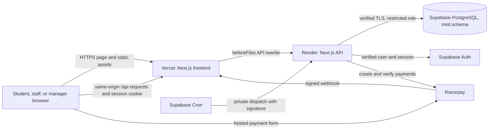

# System architecture

MINT is a modular monolith. One Next.js codebase serves the user interface and API. Domain modules run inside the API process and share one PostgreSQL database. The browser never connects directly to business tables.

For exact contracts and rules, use the [technical reference](../TECHNICAL_REFERENCE.md). This guide explains how the parts fit together.

## Runtime map

Vercel and Render build the same repository. Vercel serves pages and forwards `/api/*` requests to Render before local route handlers run. Render performs API work. The browser uses relative API paths so its session remains associated with the app origin.

The Razorpay webhook is an API request forwarded through the same frontend route. Its provider signature authenticates it; it does not use a browser session. Supabase Cron calls a private worker route with a separate signature. The worker uses the same domain modules and database as ordinary API requests.

The diagram shows configured responsibilities. It does not prove that a hosted service is healthy. Use the [deployment guide](../DEPLOYMENT.md) for release checks and current operational limits.

## Request path

Most browser requests follow this sequence:

1. A React component sends a same-origin request to `/api/...`.
2. The frontend host forwards that path to the backend host.
3. The API dispatcher in `src/app/api/[...path]/route.ts` selects the handler.
4. `src/lib/http.ts` checks origin, parses JSON, and maps errors to stable responses.
5. `src/lib/auth.ts` verifies the Supabase session for protected actions.
6. The route validates input with Zod and calls a domain module in `src/modules/`.
7. The module checks actor type and canteen or station scope, then reads or changes rows through a transaction.
8. The API returns a projected response. The UI refreshes relevant data.

The public catalogue and health check are exceptions to session authentication. Payment webhooks and worker calls use their own signatures. See [Authentication, authorization, and security](../TECHNICAL_REFERENCE.md#8-authentication-authorization-and-security) for exact trust checks.

## Code ownership

| Layer | Location | Owns |
| --- | --- | --- |
| Pages and app shell | `src/app/` | Next.js entry points, page metadata, styles, route placeholders |
| User interface | `src/components/` | Student, staff, manager, install, and reusable UI interactions |
| API transport | `src/app/api/` | HTTP routing, request parsing, and worker entry point |
| Shared server rules | `src/lib/` | Auth, environment validation, errors, payment adapter, policy helpers |
| Domain operations | `src/modules/` | Checkout, orders, credits, payments, pickup, staff, catalogue, reporting |
| Persistence | `src/db/` and `drizzle/` | Drizzle schema, database connection, ordered migrations |
| Background work | `src/jobs/` | Expiry, payment reconciliation, refund retries, health heartbeat |
| Operational tools | `scripts/` | Migrations, identity setup, menu import, verification, worker configuration |
| Checks | `tests/` | Policy, workflow, configuration, and browser behavior |

The main API file dispatches routes; it should not own multi-step business rules. Domain modules own those rules so both HTTP requests and the worker can use them.

## Data and trust boundaries

- Supabase Auth owns sign-in and session issuance. The application stores its own profile and operational roles in the private `mint` schema.
- The backend verifies the session with Supabase Auth. It does not trust a client-supplied user ID or role.
- The backend uses a restricted database role for normal runtime work. Migration tools use a separate authorized connection.
- Student access is enforced in backend modules and response projections. Database row-level security does not provide per-student business isolation.
- Razorpay owns payment capture facts. MINT records provider events and reconciles uncertain outcomes.
- The browser's reported location helps enforce pickup rules, but it is not hardware-attested proof of location.

These boundaries are important when a change adds an endpoint, response field, new role, or database connection. Detailed risks and controls are in the technical reference security section.

## State ownership

PostgreSQL is the durable source for orders, portions, inventory, credit, roles, invitations, pickup passes, provider events, audit records, and worker status. React state holds the current screen, cart, form values, and recently fetched views. The service worker caches a small set of static assets and an offline page; it does not cache API responses or accept offline orders.

The app uses polling for refreshed views. It does not use realtime subscriptions or a message broker. The worker is durable scheduled work because it records its effects in PostgreSQL and can retry them after a restart.

## Where to go next

- Follow actual state changes in [Workflows](workflows.md).
- Find route, table, and policy details in the [technical reference](../TECHNICAL_REFERENCE.md).
- Learn local setup and safe commands in [Local development](../development.md).
- Learn host configuration and release order in the [deployment guide](../DEPLOYMENT.md).
